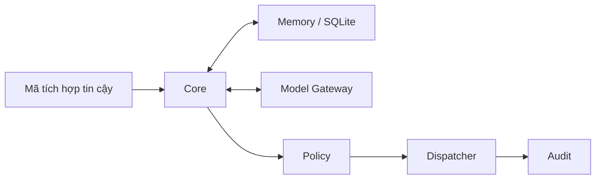

# Arona 3.0 — Hướng dẫn tiếng Việt

[English](README.md) · [Tiếng Việt](README-vi.md)

[Trạng thái và kiểm thử](RELEASE_STATUS.md) · [Bảo mật và liên hệ](SECURITY.md)

Mã nguồn của **3.0.0a1 — Experimental Core** đã được công bố tại [93hai/arona](https://github.com/93hai/arona). Đây là bản thử nghiệm: **PRODUCTION: NOT READY**.

## Arona là gì?

Hãy hình dung một trợ lý AI có thể nhớ thông tin bạn cho phép nhớ, hỏi mô hình để xử lý yêu cầu và kiểm tra quyền trước khi làm việc. Arona 3.0 xây phần lõi cho những việc đó. Phần lõi có thể được đọc, kiểm thử và tích hợp bằng mã chương trình; bản này chưa có cửa sổ chat, website hay bot Discord để người dùng trò chuyện ngay.

## Ý tưởng và mục tiêu

Ý tưởng và hướng phát triển do **93hai** đưa ra. Mục tiêu là một trợ lý có bộ nhớ nhưng không tự cấp quyền, không tự chạy mã hoặc tự triển khai thay đổi. AI hỗ trợ viết và sửa phần triển khai dưới sự hướng dẫn của con người.

Arona 3.0 là dự án độc lập với AIRI. Tên gọi hoặc kế hoạch cho các phiên bản sau không có nghĩa bản 3.0 đã có những chức năng đó.

## Tính năng hiện có

| Thành phần | Vai trò |
| --- | --- |
| Core | Điều phối yêu cầu, hội thoại ngắn hạn và khởi động/tắt ứng dụng |
| Memory | Lưu và tìm dữ liệu bằng SQLite/FTS5, tách theo `owner_id` và `workspace_id` |
| Model Gateway | Kết nối mô hình qua các bộ chuyển đổi, chuyển sang mô hình dự phòng, áp dụng thời gian chờ và ngân sách token/chi phí |
| Policy | Quyết định công cụ có được phép chạy trong ngữ cảnh hiện tại hay không |
| Dispatcher | Gọi công cụ đã đăng ký sau khi được Policy cho phép |
| Audit | Ghi nhận quyết định và kết quả, che thông tin bí mật khi ghi |
| Migration và bảo trì | Kiểm tra cấu hình, chuẩn bị cơ sở dữ liệu, sao lưu và khôi phục |
| Candidate | Lưu tệp đề xuất trong thư mục riêng, chặn vượt đường dẫn và dữ liệu bí mật |

Mã kết nối Gemini, Mistral và Codestral đã có trong dự án. Điều đó không có nghĩa các dịch vụ AI thật đã được nghiệm thu. Candidate chỉ là vùng chứa tệp đề xuất; nó không chạy mã, chạy kiểm thử hoặc triển khai ứng dụng.

## Những tính năng chưa có

Arona 3.0 chưa có giao diện trò chuyện, API công khai, WebSocket, kết nối bot Discord khi chạy, chức năng giọng nói, tích hợp AIRI hoặc Safe Runner. Bản này không triển khai tìm kiếm trên web, tự sửa lỗi, tự chạy Candidate, bộ lập lịch hoặc nền tảng mở rộng bằng plugin.

`InteractionGateway` là điểm tích hợp dành cho mã chương trình cung cấp danh tính tin cậy; không phải máy chủ mạng hay giao diện người dùng có sẵn. Các tệp trong `old version/` không được dùng để chạy Arona 3.0.

## Cài đặt trên Windows

Cần Git, Python 3.11+ và SQLite có FTS5. `pyproject.toml` khai báo Python `>=3.11`; lượt cài sạch Windows gần đây dùng Python **3.14.6**. Chưa kiểm chứng mọi tổ hợp phiên bản Python và hệ điều hành. Cài thư viện cần kết nối tới kho gói Python; các thao tác vận hành bên dưới không cần gọi dịch vụ AI.

Mở PowerShell tại nơi bạn muốn lưu dự án:

```powershell
git clone https://github.com/93hai/arona.git
cd arona
py -3 -m venv .venv
$AronaPython = Join-Path (Get-Location) '.venv\Scripts\python.exe'
& $AronaPython -m pip install --require-hashes -r requirements.lock
& $AronaPython -m pip install --no-deps .
& $AronaPython -m pip check
& $AronaPython -I -c "import arona; print(arona.__version__)"
$AronaCommand = Join-Path (Get-Location) '.venv\Scripts\arona.exe'
& $AronaCommand --help
```

Không cần kích hoạt venv hoặc dùng Administrator. `.venv` chứa môi trường Python riêng cho dự án; các lệnh dùng đúng Python của môi trường đó. `-I` giúp kiểm tra bản đã cài thay vì vô tình nhập mã nguồn từ thư mục hiện tại. CLI không hỗ trợ `--version`, nên xem phiên bản bằng lệnh Python trên.

Không cài một gói PyPI chỉ vì có tên giống dự án: các bước này cài từ mã nguồn của kho này. Chạy `--help` chỉ xem trợ giúp; nó không mở chat hay khởi động dịch vụ AI.

## Thử vận hành không cần API key

Giữ nguyên cửa sổ PowerShell vừa cài đặt. Tạo một workspace thử mới ngoài mã nguồn bằng các biến môi trường sau; phần đuôi ngẫu nhiên tránh dùng nhầm dữ liệu cũ:

```powershell
$AronaTrial = Join-Path $env:LOCALAPPDATA ('Arona3\trial-' + [guid]::NewGuid().ToString('N'))
$env:ARONA_ENV = 'development'
$env:ARONA_DATA_DIR = $AronaTrial
$env:ARONA_DB_PATH = Join-Path $AronaTrial 'memory\arona_memory.db'
$env:ARONA_BACKUP_DIR = Join-Path $AronaTrial 'backups'
$env:ARONA_CANDIDATE_DIR = Join-Path $AronaTrial 'candidate'
$env:ARONA_STATE_DIR = Join-Path $AronaTrial 'state'
$env:ARONA_LOG_DIR = Join-Path $AronaTrial 'logs'
$env:ARONA_RUNTIME_SOURCE_DIR = (Get-Location).Path

& $AronaCommand check-config
& $AronaCommand migrate --operator-id local-operator
& $AronaCommand backup --operator-id local-operator
```

`check-config` kiểm tra cấu hình; nó không chứng minh Core đã READY. `migrate` tạo/kiểm tra cấu trúc cơ sở dữ liệu SQLite. `backup` tạo bản sao, kiểm tra tính toàn vẹn và ghi kèm tệp biên nhận để xác nhận thao tác. Đây là các việc bảo trì dữ liệu, không gọi mô hình AI hoặc khởi động dịch vụ.

Các biến chỉ có hiệu lực trong phiên PowerShell hiện tại. Đừng xóa workspace cũ để làm cho kiểm tra thành công; dùng workspace thử mới nếu cần làm lại. Không sao chép nguyên `.env.example` để chạy Windows vì mẫu cấu hình dùng đường dẫn Linux.

### Thử restore

Trong workspace thử mới này, lấy tên bản sao lưu vừa tạo và khôi phục sang một cơ sở dữ liệu mới:

```powershell
$AronaBackup = Get-ChildItem -LiteralPath $env:ARONA_BACKUP_DIR -Filter 'arona_backup_*.db' |
    Sort-Object LastWriteTime -Descending | Select-Object -First 1
& $AronaCommand restore --operator-id local-operator --backup-name $AronaBackup.Name --restore-name restored.db
```

Thao tác khôi phục không ghi đè cơ sở dữ liệu đang dùng. Nếu `restored.db` đã tồn tại, lệnh phải từ chối; không xóa dữ liệu chỉ để ép lệnh thành công. Tệp biên nhận và bản sao lưu đều phải được giữ nguyên. Chi tiết và giới hạn khi tiến trình bị ngắt ở [backup/restore](docs/backup_restore.md).

### Core và lệnh serve

`serve` là lệnh khởi động Core. Nó cần ít nhất một dịch vụ AI được cấu hình khóa API, mô hình và cả hai mức giá token như `.env.example` mô tả. Nếu chưa cấu hình dịch vụ AI, lệnh thoát với mã 1 trước khi báo sẵn sàng; không thêm khóa giả vào mã nguồn để vượt kiểm tra.

Các bước bảo trì phía trên không chạy `serve`. Có thể xem trợ giúp an toàn bằng:

```powershell
& $AronaCommand serve --help
```

Trong các lượt kiểm thử đã ghi nhận, Core READY được kiểm tra bằng dịch vụ mô phỏng/cấu hình giả và chặn mạng. Đó không phải bằng chứng AI thật hoạt động. READY của Core cũng không tự tạo cửa sổ chat, bot Discord hoặc API. Mã khởi tạo nằm ở [src/arona/app.py](src/arona/app.py).

### Cấu hình cần lưu ý

Không có việc tự động tải `.env`. Chế độ phát triển có thể dùng `arona --env-file .env check-config` khi chỉ định tệp rõ ràng; chế độ production chỉ lấy biến môi trường và cấm dotenv. Nếu tệp được chỉ định trong chế độ phát triển không tồn tại, bộ nạp có thể dùng biến môi trường hoặc giá trị mặc định. Vì vậy `check-config` PASS không chứng minh tệp đó đã được đọc.

Mọi đường dẫn dữ liệu phải nằm ngoài thư mục mã nguồn và tách biệt theo cấu hình. Chế độ phát triển trên Windows cần đường dẫn tuyệt đối có ký tự ổ đĩa. Chế độ production yêu cầu Linux, tài khoản không phải root và một lượt kiểm chứng riêng. Không đặt khóa API, nhật ký, cơ sở dữ liệu hoặc bản sao lưu vào kho mã nguồn.

## Sơ đồ kiến trúc



Mô hình chỉ đưa ra đề xuất. Danh tính được cung cấp bởi phần tích hợp tin cậy; Policy quyết định quyền và Dispatcher mới gọi công cụ. Memory được gọi trong quá trình xử lý; Audit ghi nhận các bước liên quan. Xem [kiến trúc](docs/ARCHITECTURE.md) để đọc luồng đầy đủ.

## Bộ nhớ và bảo vệ dữ liệu

Memory dùng SQLite với FTS5 và các migration có phiên bản. Dữ liệu được tách theo `owner_id` và `workspace_id`; không cho mô hình tự nhận mình là người dùng khác hoặc tự cấp quyền. Admission Policy kiểm tra trước khi ghi, và khóa API/token/mật khẩu không được lưu làm Memory.

Memory, các tùy chọn người dùng và ngân sách token/chi phí có lưu bền vững qua khởi động lại. Lịch sử hội thoại ngắn hạn chỉ nằm trong RAM. Bản sao lưu vẫn chứa dữ liệu lịch sử; xóa một bản ghi hiện tại không tự xóa các bản sao lưu trước đó.

Các lệnh `/memory view`, `export`, `update`, `delete`, `forget` và `disable_auto` là quy ước cho mã tích hợp qua `InteractionGateway` đã xác thực, không phải CLI hoặc giao diện chat có sẵn. Ví dụ: `/memory view {"limit":20,"offset":0}` và `/memory disable_auto {}`. `forget` xóa Memory của đúng người dùng/workspace hiện tại, kể cả bản xóa mềm, không tác động workspace khác. Những hành động nhạy cảm vẫn chịu kiểm tra quyền và yêu cầu xác nhận; mô hình không tự được quyền gọi chúng.

Candidate chỉ nhận đường dẫn tương đối trong workspace được phép; chặn việc vượt ra ngoài đường dẫn cho phép, symlink/junction và dữ liệu bí mật. Nó không chạm Runtime/Production hoặc thực thi mã. Các ranh giới này được mô tả ở [thiết kế bảo mật](docs/SECURITY.md).

## Kiểm thử và giới hạn

| Bằng chứng đã có | Cách hiểu đúng |
| --- | --- |
| Cài wheel trong môi trường Windows sạch, nhập mô-đun/CLI, bảo trì, lưu bền vững và sao lưu/khôi phục | PASS trên Python 3.14.6 trong lượt kiểm tra đã ghi nhận |
| Bộ kiểm thử Windows đầy đủ trước khi bản chụp mã nguồn có Git | **579 passed, 1 failed, exit 1**; lỗi là kiểm thử các tệp được theo dõi cần Git |
| Kiểm thử cần Git được chạy lại trong bản sao mã nguồn Git sạch | PASS riêng; không biến lượt kiểm thử đầy đủ cũ thành một lượt đầy đủ mới đạt PASS |
| Kiểm tra bảo mật và đóng gói có phạm vi cụ thể ngày 2026-10-11 | **92 passed, exit 0** |
| Kiểm tra đóng gói và dữ liệu bí mật ở bản chụp tài liệu cuối | **6 passed, exit 0**; không phải lượt kiểm thử hồi quy đầy đủ |
| Mốc kiểm thử Debian 12 | **578 passed, 2 skipped** là bằng chứng lịch sử, không phải nghiệm thu mới của bản mã nguồn công khai |

Giữ lịch sử đầy đủ ở [RELEASE_STATUS.md](RELEASE_STATUS.md). Chưa nghiệm thu dịch vụ AI thật, chạy liên tục trong thời gian dài hoặc mất điện phần cứng; SIGKILL một tiến trình đang nhàn rỗi không thay cho kiểm tra mất điện khi đang ghi. **PRODUCTION: NOT READY**.

Chủ dự án báo các khóa API Gemini/Mistral cũ và ứng dụng Discord cũ đã được xóa. Đây là **owner-reported remediation**, không phải **provider-confirmed revocation**: người duy trì đã báo xử lý, nhưng chưa được nhà cung cấp xác nhận độc lập. Mã nguồn công khai không mang lịch sử Git riêng tư gốc; công cụ quét chỉ nhận diện các mẫu nghi ngờ, không chứng minh mọi tài khoản hoặc mọi loại dữ liệu bí mật đều an toàn. Xem [SECURITY.md](SECURITY.md).

## Đóng góp

Bạn có thể [mở issue](https://github.com/93hai/arona/issues) để hỏi cách dùng, báo lỗi không nhạy cảm hoặc đề xuất cải thiện tài liệu. Với lỗi, ghi rõ phiên bản Python/OS, lệnh thực hiện và kết quả đã che thông tin riêng. Đừng gửi thông tin xác thực, cơ sở dữ liệu, nhật ký đầy đủ hoặc nội dung Memory của bạn.

Nếu sửa mã, dùng venv đã tạo và cài thêm các thư viện/công cụ phát triển:

```powershell
& $AronaPython -m pip install --require-hashes -r requirements-dev.lock
& $AronaPython -m pip install --no-deps -e .
& $AronaPython -m pytest -q
& $AronaPython -m ruff check .
& $AronaPython scripts\scan_secrets.py
```

`python -m pytest -q` là lệnh kiểm thử hồi quy của dự án; việc ghi lệnh ở đây không có nghĩa một bộ kiểm thử đầy đủ mới đã được chạy cho lượt sửa tài liệu. Pytest cấu hình cả `src` và root trong `pythonpath`; nếu đặt `--basetemp`, chọn thư mục ngoài mã nguồn và ngoài các thư mục gốc dùng để nhập mô-đun. Không bỏ qua các kiểm tra bảo mật để lấy PASS.

Công cụ quét các tệp được Git theo dõi cần một bản sao mã nguồn có Git. Nếu dùng gói mã nguồn không có `.git`, hãy dùng bản clone hoặc tạo kho Git cục bộ mới và đưa mã đã rà soát vào vùng chuẩn bị commit; không đưa lịch sử riêng tư cũ vào. Để kiểm tra nhanh wheel đã cài ở môi trường riêng, dùng `python -I scripts/smoke_package.py --workspace` kèm thư mục tạm ngoài mã nguồn; không đặt `PYTHONPATH` để che lỗi đóng gói.

Mỗi PR nên có phạm vi rõ và cách kiểm tra. Giữ nguyên các ranh giới quyền; các lời nhắc dùng khi chạy trong `src/arona/prompts/` là giao ước được ứng dụng đọc, không phải bài giới thiệu để sửa tùy ý.

## Quyền sử dụng và ghi nhận

[MIT License](LICENSE) cho phép sử dụng, sửa đổi và phân phối theo điều kiện giữ thông báo bản quyền (copyright notice) và thông báo cấp phép (permission notice); phần mềm được cung cấp “AS IS”. **LICENSE tiếng Anh trong kho mã nguồn là văn bản chuẩn**. Một bản dịch tự động của trình duyệt không thay thế giấy phép này. Các thư viện phụ thuộc giữ giấy phép riêng ở [THIRD_PARTY_NOTICES.md](THIRD_PARTY_NOTICES.md).

Copyright **2026 93hai**. Ghi nhận dự án gốc, ý tưởng và định hướng: **[93hai](https://github.com/93hai)**. Việc lập trình được hỗ trợ đáng kể bởi AI dưới sự hướng dẫn của con người. Rà soát chưa tìm thấy xung đột quyền bên thứ ba cụ thể; đây không phải chứng nhận pháp lý độc lập cho mọi nguồn gốc hoặc nội dung do AI tạo.

## Đọc tiếp

- [Kiến trúc](docs/ARCHITECTURE.md) và [thiết kế bảo mật](docs/SECURITY.md).
- [Migration SQLite](migrations/README.md) và [sao lưu/khôi phục](docs/backup_restore.md).
- [Danh sách kiểm tra trên Linux](docs/linux_validation_checklist.md).
- [Phạm vi mã nguồn công khai](docs/public_snapshot.md) và [danh mục thành phần dự án](PROJECT_MANIFEST.md).
