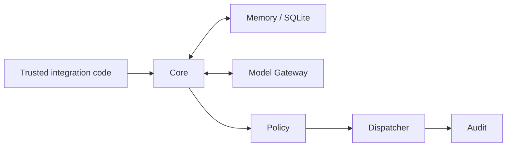

# Arona

**An experimental AI assistant core with memory and permission controls.**

[](#quick-start-on-windows)
[](LICENSE)
[](RELEASE_STATUS.md)

**3.0.0a1 — Experimental Core** · Public source · **PRODUCTION: NOT READY**

[English](README.md) · [Tiếng Việt](README-vi.md)

## What is Arona?

Arona builds the core of an AI assistant: accepting requests from trusted integration code, retrieving permitted memories, coordinating models, and checking permissions before calling tools. Version 3.0 is for developers and learners who want to explore or extend that core. It does not yet provide a ready-to-use chatbot application.

## What can version 3.0 do?

- **Core:** coordinate request processing and application lifecycle.
- **Memory:** store data by user and workspace in SQLite, with FTS5 search.
- **Model Gateway:** Gemini/Mistral/Codestral adapters, fallback and budget limits; live providers have not passed acceptance validation.
- **Policy, Dispatcher and Audit:** check permissions, call registered tools and record outcomes.
- **Maintenance:** configuration checks, migrations, backup and restore through the CLI.
- **Candidate:** read and write proposed files in a separate workspace with path controls; it does not execute code.

## Quick Start on Windows

You need Git, Python **3.11+**, and SQLite with FTS5. The recent clean Windows installation was validated specifically on **Python 3.14.6**; this does not establish compatibility with every Python version. Run these commands in PowerShell. Virtual environment activation and Administrator privileges are not required:

```powershell
git clone https://github.com/93hai/arona.git
cd arona
py -3 -m venv .venv
$AronaPython = Join-Path (Get-Location) '.venv\Scripts\python.exe'
& $AronaPython -m pip install --require-hashes -r requirements.lock
& $AronaPython -m pip install --no-deps .
& $AronaPython -m pip check
& $AronaPython -I -c "import arona; print(arona.__version__)"
& .\.venv\Scripts\arona.exe --help
```

These commands install Arona and check its CLI; they do not start a provider or a chatbot. The [Vietnamese guide](README-vi.md#thử-vận-hành-không-cần-api-key) shows how to try maintenance without API keys using disposable data **outside the source tree**. The CLI has no `--version` option; use the Python command above.

## Architecture at a glance



This diagram describes internal processing, not an available network API. See the [architecture documentation](docs/ARCHITECTURE.md) for details.

## Current limitations

Arona 3.0 has no chat UI, public API, WebSocket, Discord runtime transport, voice, AIRI integration or Safe Runner. It also has no Web Search, automatic Candidate execution, Self-Correction, Scheduler or Plugin platform. The `old version/` directory is retained for regression tests; it is not a supported bot.

Live-provider acceptance, extended soak testing and real power-loss recovery remain unverified. Conversation history is held in RAM; Memory and budgets persist across restarts. Read the [release status and validation evidence](RELEASE_STATUS.md) before integrating or deploying Arona.

## Documentation

Detailed documentation is currently in Vietnamese.

| To… | Read |
| --- | --- |
| Understand the project and try it on Windows | [Vietnamese guide](README-vi.md) |
| Review status, test counts and validation limits | [Release status](RELEASE_STATUS.md) |
| Understand architecture and permission boundaries | [Architecture](docs/ARCHITECTURE.md) · [Security design](docs/SECURITY.md) |
| Manage data | [Backup/restore](docs/backup_restore.md) · [Migrations](migrations/README.md) |
| Prepare Linux validation | [Linux checklist](docs/linux_validation_checklist.md) |
| Review the public source scope | [Project manifest](PROJECT_MANIFEST.md) · [Public snapshot](docs/public_snapshot.md) |

## Contributing

[Open an issue](https://github.com/93hai/arona/issues) for questions or nonsensitive bugs. For pull requests, describe your changes and how you checked them, preserving the permission boundaries and version 3.0 scope. Developer commands are in the [Vietnamese contribution guide](README-vi.md#đóng-góp). Do not include credentials, databases, private logs or user data in issues or pull requests.

## Origin, license and security

**[93hai](https://github.com/93hai)** created the original project concept and direction. Implementation was extensively AI-assisted under human direction. Arona 3.0 is independent of AIRI; the provenance review identified no AIRI-derived foundation or assets in this version.

[MIT License](LICENSE) — Copyright **2026 93hai**. Dependencies retain their own licenses in [THIRD_PARTY_NOTICES.md](THIRD_PARTY_NOTICES.md). AI assistance does not establish that all third-party rights have been cleared.

See [SECURITY.md](SECURITY.md) for sensitive vulnerability reporting and historical credential risks. Deletion of old keys and applications is **owner-reported**, not independently **provider-confirmed**. A clean public source snapshot does not establish the security state of provider accounts.
