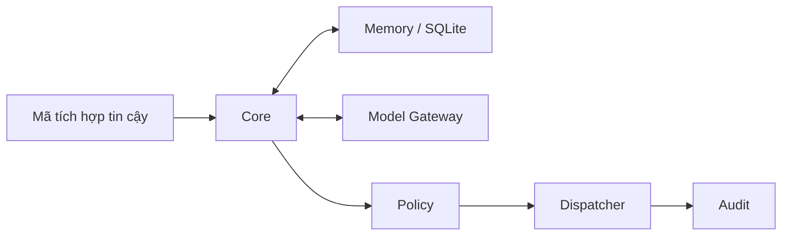

# Arona

**Nền tảng lõi cho một trợ lý AI có bộ nhớ và kiểm soát quyền.**

[](README.vi.md#cài-đặt-trên-windows)
[](LICENSE)
[](RELEASE_STATUS.md)

**3.0.0a1 — Experimental Core** · Source đã công khai · **PRODUCTION: NOT READY**

[Giới thiệu ngắn](README.md) · [Hướng dẫn tiếng Việt](README.vi.md) · [Trạng thái và kiểm thử](RELEASE_STATUS.md)

## Arona là gì?

Arona xây phần “lõi” của một trợ lý: tiếp nhận yêu cầu từ mã tích hợp, tìm thông tin được phép nhớ, điều phối mô hình và kiểm tra quyền trước khi gọi công cụ. Bản 3.0 dành cho người muốn đọc, học hoặc phát triển phần lõi này; chưa phải ứng dụng chatbot có thể mở lên và trò chuyện ngay.

## Bản 3.0 hiện có gì?

- **Core:** điều phối xử lý yêu cầu và vòng đời ứng dụng.
- **Memory:** lưu dữ liệu theo người dùng và workspace bằng SQLite, có tìm kiếm FTS5.
- **Model Gateway:** adapter Gemini/Mistral/Codestral, fallback và giới hạn ngân sách; live provider chưa được nghiệm thu.
- **Policy, Dispatcher và Audit:** kiểm tra quyền, gọi công cụ đã đăng ký và ghi nhận kết quả.
- **Vận hành:** kiểm tra cấu hình, migration, backup và restore qua CLI.
- **Candidate:** đọc/ghi tệp đề xuất trong vùng riêng, có kiểm soát đường dẫn; không chạy code.

## Bắt đầu trên Windows

Cần Git, Python **3.11+** và SQLite có FTS5. Lượt cài sạch Windows gần đây được kiểm chứng trên **Python 3.14.6**; không phải xác nhận cho mọi phiên bản Python. Chạy trong PowerShell, không cần kích hoạt venv hoặc quyền Administrator:

```powershell
git clone https://github.com/93hai/arona.git
cd arona
py -3 -m venv .venv
$AronaPython = Join-Path (Get-Location) '.venv\Scripts\python.exe'
& $AronaPython -m pip install --require-hashes -r requirements.lock
& $AronaPython -m pip install --no-deps .
& $AronaPython -m pip check
& $AronaPython -I -c "import arona; print(arona.__version__)"
& .\.venv\Scripts\arona.exe --help
```

Đoạn này chỉ cài đặt và kiểm tra CLI, chưa bật provider hoặc tạo chatbot. Xem [cách thử maintenance không cần API key](README.vi.md#thử-vận-hành-không-cần-api-key) để tạo dữ liệu thử **ngoài source**. CLI không có `--version`; dùng lệnh Python ở trên.

## Kiến trúc thu gọn



Đây là luồng xử lý trong lõi, không phải một API mạng có sẵn. Chi tiết ở [tài liệu kiến trúc](docs/ARCHITECTURE.md).

## Giới hạn hiện tại

Chưa có chat UI, public API, WebSocket, Discord runtime transport, voice, AIRI integration hoặc Safe Runner. Arona 3.0 cũng không có Web Search, tự thực thi Candidate, Self-Correction, Scheduler hay Plugin platform. Thư mục `old version/` chỉ phục vụ kiểm thử, không phải bot được hỗ trợ.

Live provider, soak dài và power-loss thật chưa được nghiệm thu. Conversation history ở RAM; Memory và ngân sách có lưu bền vững. Xem [giới hạn và bằng chứng kiểm thử](RELEASE_STATUS.md) trước khi tích hợp hoặc triển khai.

## Tài liệu

| Bạn muốn… | Đọc tại |
| --- | --- |
| Hiểu dự án và thử trên Windows | [README.vi.md](README.vi.md) |
| Xem trạng thái, số liệu và giới hạn kiểm thử | [RELEASE_STATUS.md](RELEASE_STATUS.md) |
| Đọc kiến trúc và các ranh giới quyền | [Kiến trúc](docs/ARCHITECTURE.md) · [Bảo mật](docs/SECURITY.md) |
| Quản lý dữ liệu | [Backup/restore](docs/backup_restore.md) · [Migration](migrations/README.md) |
| Chuẩn bị kiểm chứng Linux | [Checklist Linux](docs/linux_validation_checklist.md) |
| Xem phạm vi source công khai | [Project manifest](PROJECT_MANIFEST.md) · [Public snapshot](docs/public_snapshot.md) |

## Đóng góp

[Mở issue](https://github.com/93hai/arona/issues) cho câu hỏi hoặc lỗi không nhạy cảm. Khi gửi pull request, mô tả thay đổi và cách kiểm tra; giữ các ranh giới quyền và phạm vi 3.0. [Hướng dẫn đóng góp](README.vi.md#đóng-góp) có các lệnh dành cho người phát triển. Không gửi key, database, log riêng hoặc dữ liệu người dùng trong issue/PR.

## Nguồn gốc, quyền sử dụng và bảo mật

Dự án gốc và định hướng do **[93hai](https://github.com/93hai)** tạo; phần triển khai được hỗ trợ đáng kể bởi AI dưới sự hướng dẫn của con người. Arona 3.0 độc lập với AIRI và không chứa foundation hoặc asset AIRI được xác định trong lượt review.

[MIT License](LICENSE) — Copyright **2026 93hai**. Dependency giữ giấy phép riêng trong [THIRD_PARTY_NOTICES.md](THIRD_PARTY_NOTICES.md); AI assistance không tự chứng minh mọi quyền bên thứ ba đã được xử lý.

Xem [SECURITY.md](SECURITY.md) để báo lỗi nhạy cảm và hiểu rủi ro credential lịch sử. Việc xóa key/application cũ là **owner-reported**, chưa **provider-confirmed**; source sạch không chứng minh trạng thái tài khoản provider.
